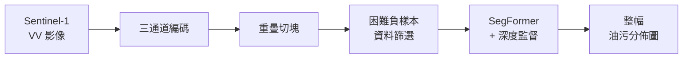

# Oil-Spill Segmentation on Large-Scale SAR Imagery

從整幅 Sentinel-1 衛星雷達影像中分割海上油污的深度學習流程，涵蓋影像前處理、切塊、訓練資料篩選，以及模型訓練與評估。

## 流程



- **三通道編碼**：把單通道 VV 影像轉成 pseudo-RGB，加入不同尺度的後向散射統計，並以 OpenStreetMap 陸地遮罩修正陸地造成的統計誤差
- **重疊切塊**：油污區域密集取樣、純背景區域稀疏取樣，降低冗餘背景
- **困難負樣本篩選**：以 EL2N 分數找出容易誤判的背景區塊，再用 submodular 選擇兼顧地理分層與多樣性，挑出精簡的訓練子集
- **訓練與推論**：SegFormer-B5 加上深度監督輔助頭，損失函數結合 Focal 與 soft-Jaccard IoU loss；推論時以滑動視窗拼回整幅結果
- **評估**：5 折交叉驗證，計算 IoU、mIoU、F1、HD95，並支援 Grad-CAM 可解釋性分析

## 快速開始

```bash
pip install -r requirements.txt     # PyTorch 需另依 CUDA 版本安裝，見檔案開頭說明
python check_env.py                 # 檢查環境
./retarget_paths.sh /path/to/project --apply   # 將路徑換成本機位置

python -m main_cross_validation.main_runner --config experiments_crop2048_close.yaml
```

完整的前處理流程見 [`preprocessing/README.md`](preprocessing/README.md)，訓練設定與模型說明見 [`main_cross_validation/PROJECT_MANUAL.md`](main_cross_validation/PROJECT_MANUAL.md)。

## 專案結構

```
├── preprocessing/          # 三通道編碼、切塊、困難負樣本篩選
└── main_cross_validation/  # 模型訓練、評估、交叉驗證
    ├── adapters/           # SegFormer、SegFormer + 深度監督、OSDMamba
    └── models/             # OSDMamba、RS3Mamba、FA-MobileUNet 實作
```

## 資料

- 私有的大尺度 Sentinel-1 VV 整幅影像資料集（未隨本 repo 公開）
- 公開的 SAR 油污分割基準資料集 M4D（[Krestenitis et al., 2019](https://doi.org/10.3390/rs11151762)），前處理腳本位於 `preprocessing/m4d/`

## 技術

Python · PyTorch · SegFormer · Mamba · Hugging Face Transformers · OpenCV · scikit-learn · rasterio
